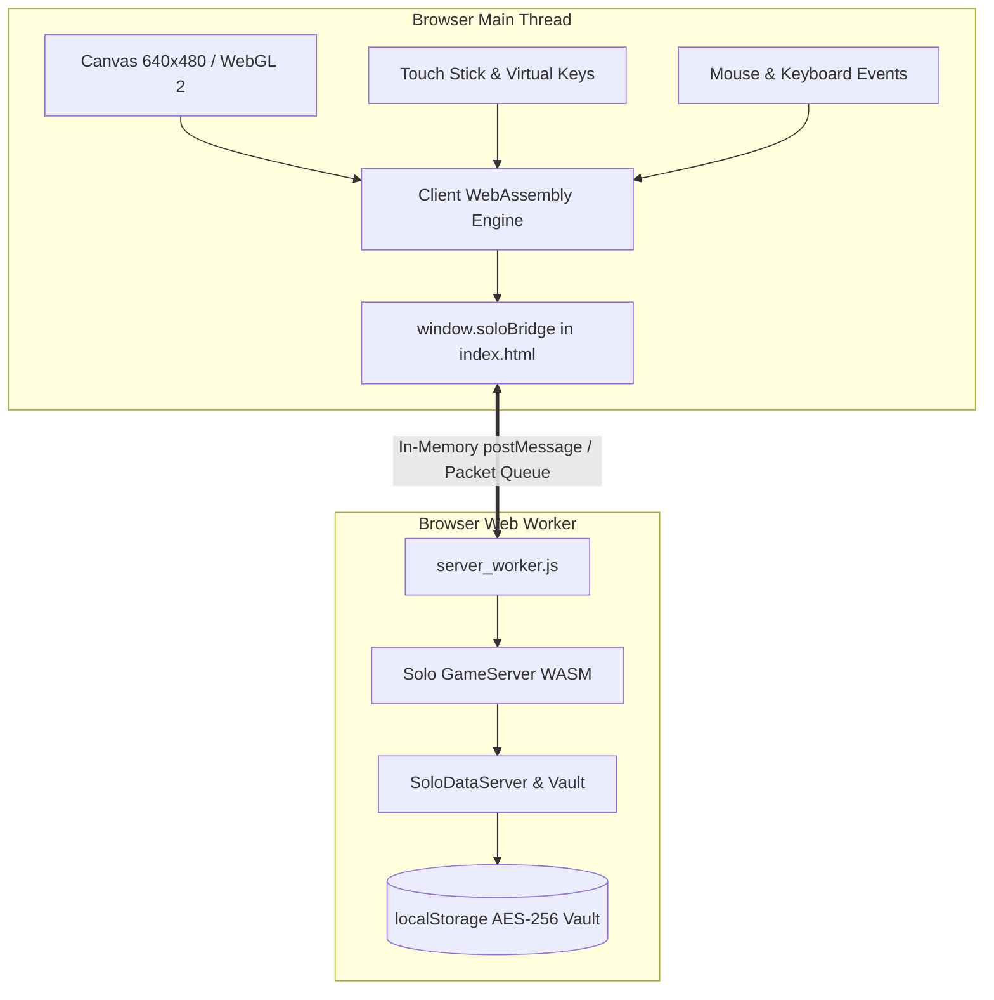

# MU Online 0.97k — WebGL2 Browser Client Architecture

This document describes the architecture, subsystems, compilation pipeline, and in-memory networking of the browser-playable, standalone single-player MU Online 0.97k client.

---

## 1. Overview & Vision

The project ports the reconstructed C++ Win32 MU Online 0.97k client directly into WebAssembly (wasm32) and WebGL 2, creating a 100% client-side, browser-playable single-player action RPG.

### Core Principles
- **100% Standalone & Offline**: Runs entirely inside modern desktop and mobile browsers. No external server, gateway, or internet connection required.
- **Original 0.97k Look & Feel**: Faithful classic gameplay, authentic 3D BMD models, equipment glows, Lorencia music, sound effects, and UI layouts.
- **Zero-Network In-Memory Bridge**: Game network packets move in-memory between the WebGL client thread and the GameServer Web Worker (`server_worker.js`).
- **Modern User Experience**: Fast 3-realm difficulty selector (Easy 300x, Medium 100x, Hard 30x) with seamless, passwordless auto-login directly into character creation.

---

## 2. System Architecture



### 2.1 Subsystems Structure (`src/client/src/`)
The client source contains 24 modular subsystems:
- **`Combat/`**: Player and monster attack resolution, damage calculations, hit animations.
- **`Config/`**: Settings loader, sound volumes, screen resolution, `ServerConfig.h`.
- **`Core/`**: Window abstraction, font surface renderer, input dispatchers.
- **`Entity/`**: Character entities, NPC instances, monster pools.
- **`Game/`**: `Game_MainLoop`, scene state machine, tick timers.
- **`Item/`**: Inventory grid logic, item attributes, BMD parsers (`Item.bmd`, `Skill.bmd`, `Quest.bmd`).
- **`Local/`**: Text data loader, multilingual strings (`GlobalText`).
- **`Math/`**: 3D vector and matrix math, bounding boxes, ray-casting.
- **`Model/`**: BMD model management, bone transformations, mesh attachments.
- **`Monster/`**: Monster animations, movement, actions.
- **`Net/`**: Protocol encoders/decoders (`ProtocolCore`, `Recv_Account`, `Recv_Character`), packet crypto.
- **`Render/`**: WebGL rendering pipeline, `BMD__RenderMesh`, terrain renderer, particle pools.
- **`Scene/`**: Scene state handlers (`Scene_Login`, `Scene_Login_ServerSelect`, `Scene_CharSelect`).
- **`Sound/`**: Audio manager, `miniaudio` WebAudio backend for MP3 and WAV effects.
- **`Terrain/`**: Lorencia terrain mesh, lightmaps, attribute collision grid.
- **`UI/`**: Game HUD, dialog windows, chat overlay, character creation interface.

---

## 3. Zero-Network In-Memory Bridge

Instead of using traditional TCP sockets or external WebSocket proxy servers, the client connects to the in-browser GameServer worker via `src/client/browser/net_ws.cpp`:

1. **Client Connection (`mu_net_connect`)**:
   - Reads the selected server difficulty (`ServerSelectHi`).
   - Calls JavaScript `window.soloBridge.connect(realmMode)`.
   - Signals `post_event(FD_WRITE)` to mark the virtual socket open.
2. **Packet Transmission (`mu_net_send`)**:
   - Outgoing packets are intercepted and passed to JavaScript via `window.soloBridge.send(uint8Data)`.
   - The bridge forwards the packet to `server_worker.js` with `{ action: 'SEND_PACKET', payload: { bytes } }`.
3. **Packet Reception (`mu_net_push_packet`)**:
   - When `server_worker.js` generates packets for the client, it posts `{ type: 'PACKET_FROM_SERVER', data }`.
   - JavaScript calls the exported WebAssembly function `Module._mu_net_push_packet(ptr, len)`.
   - The C++ bridge buffers the bytes in `g_in` and fires `post_event(FD_READ)`, delivering packets to `mu_net_recv` and `Recv_*` protocol handlers.

---

## 4. Server Selection & Direct Passwordless Login

### 4.1 Three Difficulty Realms
The server selection screen (`Scene_Login_ServerSelect.cpp`) displays 3 distinct realms:
- 🟢 **Arcadia [Easy]**: 300x EXP, High Item Drop (150%), Zen Drop 100%, Reset Level 300, Grand Reset 50 resets.
- 🟡 **Valhalla [Medium]**: 100x EXP, Classic Drop (100%), Zen Drop 50%, Reset Level 400, Grand Reset 100 resets.
- 🔴 **Asgard [Hard]**: 30x EXP, Hardcore Drop (50%), Zen Drop 25%, Reset Level 400, Grand Reset 150 resets.

### 4.2 Seamless Flow to Character Creation
1. The user selects a difficulty realm (or clicks its channel).
2. The client initiates connection to the solo server.
3. The server responds with `F1 00 01` (`GCConnectClientSend` / JoinServer).
4. `Recv_JoinServer` skips the credential input dialog (`DAT_083a7c14 = 3`) and automatically sends `SendLogin("solo", "solo")`.
5. The solo server approves the session (`F1 01 01`).
6. `Recv_LoginResult` receives success and transitions to `SceneFlag = 4`.
7. The client automatically requests the character list (`F3 00`) and displays the 3D character creation/selection podium without asking for passwords.

---

## 5. Build and Linking Pipeline

### Prerequisites
- **Emscripten 6.0.12** (`emcc`, `clang` wasm32).
- **Python 3.10+** (included in EMSDK).

### Build Command
To compile client source changes and produce the updated WebAssembly binaries:
```cmd
src\client\link-login.bat
```

What `link-login.bat` does:
1. Initializes the Emscripten environment via `emsdk_env.bat`.
2. Gathers the 333 precompiled subsystem objects (`*.o`).
3. Compiles `src/client/browser/shell_login.cpp` and `src/client/browser/net_ws.cpp`.
4. Links the WebAssembly executable with legacy fixed-function WebGL emulation (`-sLEGACY_GL_EMULATION -sGL_FFP_ONLY -sMIN_WEBGL_VERSION=2`).
5. Packages preloaded game assets (`--preload-file login-data@/Data`) into `shell_login.data`.
6. Executes `patch-login-page.ps1` to apply WebGL batching optimizations.
7. Copies `shell_login.wasm`, `shell_login.js`, and `shell_login.html` directly to `web/index.html`.

---

## 6. Directory Layout

```text
src/client/
├── browser/               # Browser runtime shell and bridge
│   ├── net_ws.cpp         # In-memory network bridge to server worker
│   ├── shell_login.cpp    # WebGL2 client main loop & input adapters
│   ├── mu_mesh_draw.cpp   # WebGL2 mesh drawing optimizations
│   └── shell.html         # HTML shell template
├── docs/                  # Documentation
│   ├── client-architecture.md   # This document
│   └── platform-dependencies.md # Win32 API to WebGL2/WASM mapping
├── lib/                   # Bundled dependencies
│   ├── libjpeg/           # IJG libjpeg 6b
│   └── miniaudio/         # miniaudio WebAudio engine
├── src/                   # 24 reconstructed C++ subsystems
├── link-login.bat         # Client build and link script
└── patch-login-page.ps1   # Post-link WebGL patcher
```
